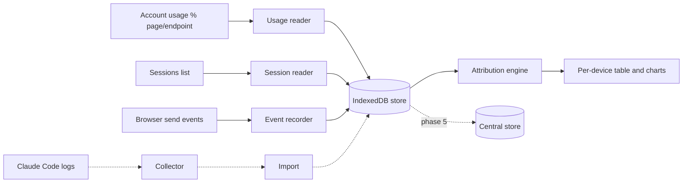

# 02 - Architecture

## Components (all inside or beside the extension)
1. **Usage reader**: reads 5-hour % and weekly % (existing code, extended to keep history).
2. **Session reader**: reads the sessions list (device label, Created, Updated, which row is Current).
3. **Event recorder** (optional): notes that a message was sent from this browser (timestamp only).
4. **Store**: IndexedDB in the extension (readings, sessions, session_updates, events, attribution).
5. **Attribution engine**: pure function over the store, runs after each new reading.
6. **UI**: extension page with the per-device table and charts; optional content script that adds
   the two columns to the settings page.
7. **Sync (phase 5, optional)**: lets several browsers share one store, so no single browser must stay open.
8. **Collector (optional)**: parses Claude Code logs and exports per-device token evidence.

## Data flow

## Single-instance mode (start here)
One browser with the extension, kept open, can read the **whole** sessions list (it shows all devices)
and the account %. That is enough for attribution through "Updated" changes, with no sync.
Weakness: if that browser is closed or asleep, readings have gaps and attribution in those gaps is Unattributed.

## Multi-instance mode (phase 5)
Install the extension on each browser (Chrome Windows, Chrome Mac, Edge). Each posts readings and events to
one private store. More coverage, finer intervals, and "Current" tags give each install its own device identity.

## Device identity
- The sessions-list row marked **Current** is the browser the extension runs in, so it names itself automatically.
- Other rows are keyed by a salted hash of (label + Created).
- The user can set an alias ("Home PC") and merge rows into one device, since a re-login creates a new row for the same machine.
